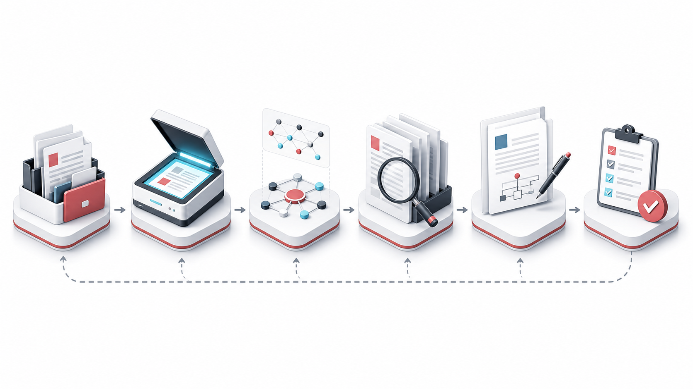

<div align="center">

# cn-patent

**面向中国发明专利的 Agent Skill：从项目材料到可交付的技术交底书。**

[](https://github.com/Zaoqu-Liu/cn-patent/actions/workflows/ci.yml)
[](LICENSE)
[](https://www.python.org/)
[](https://nodejs.org/)


</div>

`cn-patent` 让代码 Agent 能够阅读项目说明、设计文档、源代码、Word/PPT 材料和已有交底书草稿，完成专利点挖掘、国知局优先查新、技术交底书撰写、图示渲染、Markdown/Word 交付和迭代修订留档。

它专注于**中国发明专利技术交底书**，不替代专利代理师。它交付的是结构化技术材料和可复核证据链，便于发明人、研发团队、IP 团队和代理师继续审阅、补充和定稿。

## 适合什么时候用

- 把项目材料整理成中文技术交底书。
- 从代码、架构文档、会议纪要、Word 或 PPT 中挖掘 3-5 个候选专利点。
- 优先使用国家知识产权局公布公告数据做查新，再用公开网页资料补充。
- 在扫描前把 `.docx` / `.pptx` 转成 Markdown，减少二进制文档漏读。
- 生成带时间戳的 `.md` + `.docx` 交底书，并把 mermaid 图渲染成图片。
- 在已有交底书上合并新材料或纠正事实，同时保留旧稿。
- 把第五章“技术关键点和欲保护点”收紧到已有技术方案能够支持的范围内。

## 产出什么

| 产物 | 用途 |
| --- | --- |
| `案件名_YYYYMMDDHHmmss.md` | 可审阅的 Markdown 交底书，图示已替换为图片引用 |
| `案件名_YYYYMMDDHHmmss.docx` | 供代理师或内部评审使用的 Word 文档 |
| `mermaid_figures/*.png` | 由 mermaid 渲染出的系统框图和流程图 |
| `交底书修订对话记录.md` | 合并/纠错迭代的追加式修订记录 |
| 第一章 1.1 查新记录 | 带公开来源 URL 的现有技术条目 |

## 工作流



1. **立项澄清**：确认项目路径、技术主题、保密边界和联系人占位信息。
2. **材料扫描**：阅读源材料；遇到 Word/PPT 先转 Markdown 再分析。
3. **专利点挖掘**：整理候选方向，选择最适合作为一篇交底书的技术方案。
4. **查新对比**：优先查询国家知识产权局公布公告数据，必要时补充 Google Patents / 学术来源 / 公开网页。
5. **交底书撰写**：围绕“技术问题 -> 技术方案 -> 技术效果”写成完整文稿。
6. **图示和 Word**：把 mermaid 图渲染成 PNG，并导出 Word。
7. **质量自检**：检查充分公开、支持性、章节一致性、参数一致性和来源 URL。
8. **迭代修订**：补材料或纠错时另存新时间戳文件，不覆盖旧稿。

## 安装

### Codex

```bash
mkdir -p ~/.codex/skills
git clone https://github.com/Zaoqu-Liu/cn-patent ~/.codex/skills/cn-patent
```

安装后重启 Codex。

### Claude Code

```bash
mkdir -p .claude/skills
git clone https://github.com/Zaoqu-Liu/cn-patent .claude/skills/cn-patent
```

### Cursor

```bash
mkdir -p ~/.cursor/skills
git clone https://github.com/Zaoqu-Liu/cn-patent ~/.cursor/skills/cn-patent
```

安装后重启宿主应用，让它重新发现 `SKILL.md`。

更完整的安装说明见 [INSTALL.md](INSTALL.md)。

## 可选依赖

按实际需要安装，不必一次装完。

```bash
# Word/PPT 转 Markdown，以及 Markdown 导出 Word
pip install -r requirements.txt
```

```bash
# 国家知识产权局公布公告检索辅助脚本
pip install -r tools/requirements-cnipa.txt
python -m playwright install chromium
```

```bash
# mermaid 图示渲染
cd tools
npm install
```

如果国知局检索依赖未安装，或官方站点临时不可用，工作流会降级到公开网页检索，并在回复中说明使用了降级路径。

## 第一次怎么试

仓库内置了一个小型虚构案例，不需要上传真实项目代码。

```text
Use $cn-patent to scan examples/quickstart-case/knowledge and draft a Chinese technical disclosure.
Keep company/product names generic, run prior-art search if available, and export both Markdown and Word.
```

真实项目可以这样说：

```text
Use $cn-patent on /path/to/project. Focus on the scheduling module and generate a Chinese invention disclosure.
```

已有交底书需要修订时：

```text
Use $cn-patent to revise outputs/<case>/<draft>.md using this new design note. Save a new timestamped Markdown and Word file; do not overwrite the previous draft.
```

## 质量门禁

`cn-patent` 对中国发明专利交底书的核心要求比较严格：

- 每个被选中的专利点都要有清晰的**技术问题 -> 技术方案 -> 技术效果**链路。
- 第一章 1.1 的每条现有技术都要有可核验公开 URL。
- 第二章的问题要来自第一章的现有技术局限。
- 第三章要让本领域技术人员能够据此实施。
- 第四章的优点要能回到第三章的具体技术手段。
- 第五章的保护点必须由第三章或第六章支持，不能首次引入新事实。
- 软件、AI、算法和数据处理类主题必须写清具体技术手段和技术效果，不能只写商业规则或展示逻辑。

详细门禁见 [references/cn-patent-quality.md](references/cn-patent-quality.md)。其中已纳入国家知识产权局《专利审查指南》基础文本及 2025 年第 84 号修改决定中已经施行的相关口径。

## 仓库结构

```text
cn-patent/
├── SKILL.md
├── agents/openai.yaml
├── prompts/
├── references/
├── tools/
├── examples/
├── docs/assets/
├── tests/
├── requirements.txt
└── INSTALL.md
```

仓库根目录就是可安装的 skill 根目录。安装到宿主 `skills/` 目录时，请保持 `SKILL.md` 位于 `cn-patent/` 根部。

## 本地验证

```bash
python tests/test_skill_contract.py
python -m py_compile tools/*.py tests/*.py
python tools/md_to_docx.py -i examples/quickstart-case/expected/minimal-disclosure.md -o /tmp/cn-patent-smoke.docx
```

Codex skill 结构校验：

```bash
python ~/.codex/skills/.system/skill-creator/scripts/quick_validate.py .
```

安装 Playwright 后，可选跑一次国知局实时链路：

```bash
CNIPA_EXPECT_HITS=1 python tests/test_cnipa_epub_chain.py 知识图谱
```

这项依赖官方站点和本机浏览器环境，因此不放进 CI。

## 真实项目注意事项

- 未获授权时，不要把保密代码、商业秘密或客户材料发送到第三方服务。
- 原始证据材料和生成产物建议分目录存放。
- 生成交底书是技术撰写材料。申请策略、权利要求定稿、授权前景和侵权风险仍应由合格专利专业人员复核。

## License

MIT License. Copyright (c) 2026 Zaoqu Liu.
